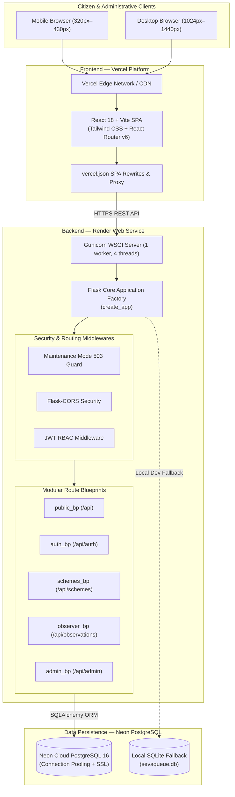
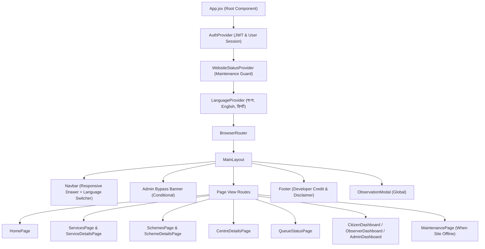
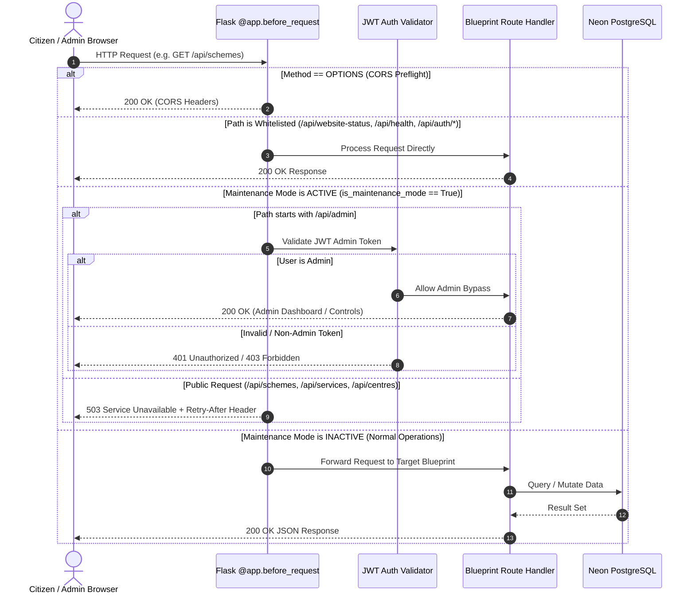
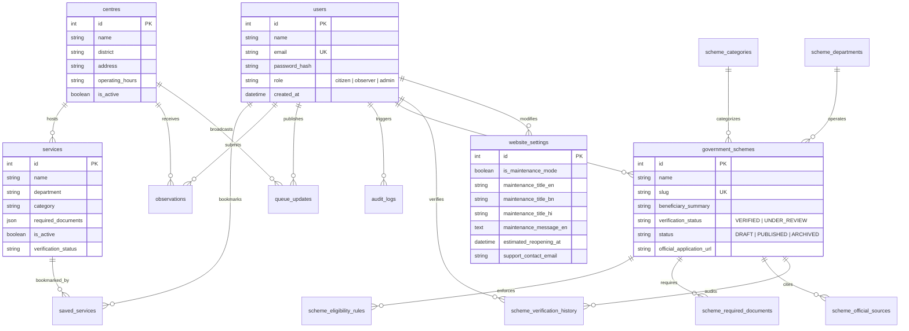

# Seva Setu — System Architecture & Design Specification

> **Platform:** Seva Setu (Citizen Information & Public Service Guide for West Bengal)  
> **Status:** Live & Active  
> **Target Audience:** Developers, System Architects, DevOps, AI Coding Agents

---

## 1. Architectural Overview

Seva Setu is architected as a decoupled, cloud-native **Single Page Application (SPA)** with a Python **RESTful API** backend and a serverless **PostgreSQL** relational database.



---

## 2. Frontend Architecture

### 2.1 Technology Stack
* **Framework:** React 18
* **Build System:** Vite 5 with Rollup chunking
* **Styling:** Tailwind CSS with custom government color tokens (`#173B72` Navy, `#2878C8` Digital Blue, `#F39A32` Saffron)
* **Routing:** React Router DOM v6 with declarative protected route guards
* **Icons:** Lucide React
* **Data Visualization:** Recharts (Admin analytics charts)
* **HTTP Client:** Axios with dynamic base URL and global interceptors

### 2.2 Component Hierarchy & State Flow



### 2.3 Context Providers
1. **`AuthContext` (`frontend/src/context/AuthContext.jsx`)**:
   - Manages user authentication state, token storage (`localStorage.getItem('sevasetu_token')`), user profile, and role helpers (`isAdmin`, `isObserver`, `isCitizen`).
2. **`WebsiteStatusContext` (`frontend/src/context/WebsiteStatusContext.jsx`)**:
   - Polls `GET /api/website-status` and listens to global Axios 503 response codes.
   - Provides `isMaintenanceMode`, multilingual announcement text, estimated reopening countdown data, and dynamic refresh controls.
3. **`LanguageContext` (`frontend/src/context/LanguageContext.jsx`)**:
   - Manages 3 supported languages: Bengali (`bn`), English (`en`), and Hindi (`hi`).
   - Persists user language preference in `localStorage.getItem('sevasetu_lang')` and dispatches browser custom events.

---

## 3. Backend Architecture

### 3.1 Application Factory Pattern
The Flask backend is structured using the **Application Factory pattern** in `backend/app/__init__.py`:

```python
def create_app(config_class=Config):
    app = Flask(__name__)
    app.config.from_object(config_class)
    db.init_app(app)
    CORS(app, origins=app.config.get('CORS_ORIGINS'), supports_credentials=True)
    ...
```

This architecture allows:
- Clean test isolation.
- Uniform execution across local development, Gunicorn WSGI on Render (`app.py`), and serverless environments (`api/index.py`).
- Centralized middleware and blueprint registration.

### 3.2 Security & Interception Middleware



---

## 4. Database Architecture

### 4.1 Connection & Pooling Configuration
Defined in `backend/config.py`:
- **SSL Mode:** Mandatory in cloud environments (`sslmode=require`).
- **Driver Agnostic:** Dynamically selects `psycopg` (v3) or `psycopg2-binary` (v2) based on the runtime environment.
- **Connection Health:** `pool_pre_ping=True` ensures stale or severed pooled connections are refreshed before queries execute.
- **Local Fallback:** If `DATABASE_URL` is omitted or contains template placeholders, the app gracefully spins up a local SQLite database (`sevaqueue.db`).

### 4.2 Entity Relationship Map



---

## 5. Deployment Architecture

| Dimension | Frontend | Backend | Database |
| :--- | :--- | :--- | :--- |
| **Hosting Platform** | **Vercel** | **Render** | **Neon** |
| **Service Type** | Static Edge Network / CDN | Linux Web Service | Serverless PostgreSQL 16 |
| **Runtime** | Node.js (Build-time only) | Python 3.11.9 | PostgreSQL Engine |
| **Entry Point** | `dist/index.html` | `app.py` / `gunicorn app:app` | Connection Pooler Port 5432 |
| **Routing / Rewrites** | `vercel.json` SPA Fallback + `/api/(.*)` Proxy | Flask URL Map | Neon Database Cluster |
| **Scaling** | Global Anycast Edge | Free Tier (Auto-sleeps on idle) | Serverless Compute Autoscaling |
| **Domain** | `sevasetu-flax-kappa.vercel.app` | `sevasetu-mb4e.onrender.com` | `ep-patient-field-b3u4vghe-pooler...` |

---

## 6. Offline Resilience Strategy

To guarantee that citizens never experience a broken UI due to cloud host spin-ups or network interruptions:
1. **Fallback Scheme Directory (`frontend/src/data/fallbackSchemes.js`)**:
   - The frontend packages 7 verified West Bengal government schemes (*Kanyashree Prakalpa*, *Lakshmir Bhandar*, *Swasthya Sathi*, *Krishak Bandhu*, *Yuvasree*, *Jai Bangla Pension*, *Snehaloy Housing Scheme*).
   - If the Render backend is cold-starting, undergoing maintenance, or unreachable, the frontend dynamically loads the verified offline cache.
2. **Local Checklist Persistence**:
   - Citizen document preparation checkboxes are tracked in the browser's `localStorage` per scheme slug (`sevasetu_scheme_checklist_<slug>`), ensuring no data loss when navigating or refreshing.
3. **Graceful Status Interception**:
   - When maintenance mode is switched ON by an administrator, the backend returns HTTP 503 while the frontend renders `<MaintenancePage />` with Bengali, English, and Hindi text, live countdowns, and a discrete portal for administrators to log in and restore public access.

